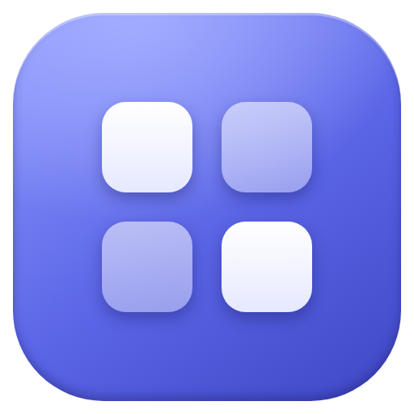
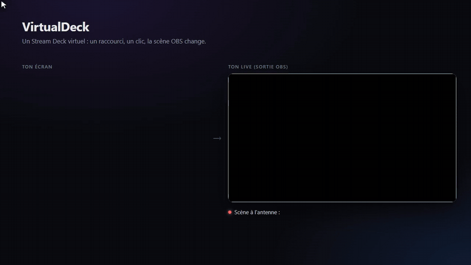
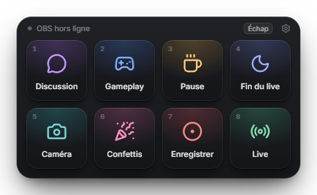
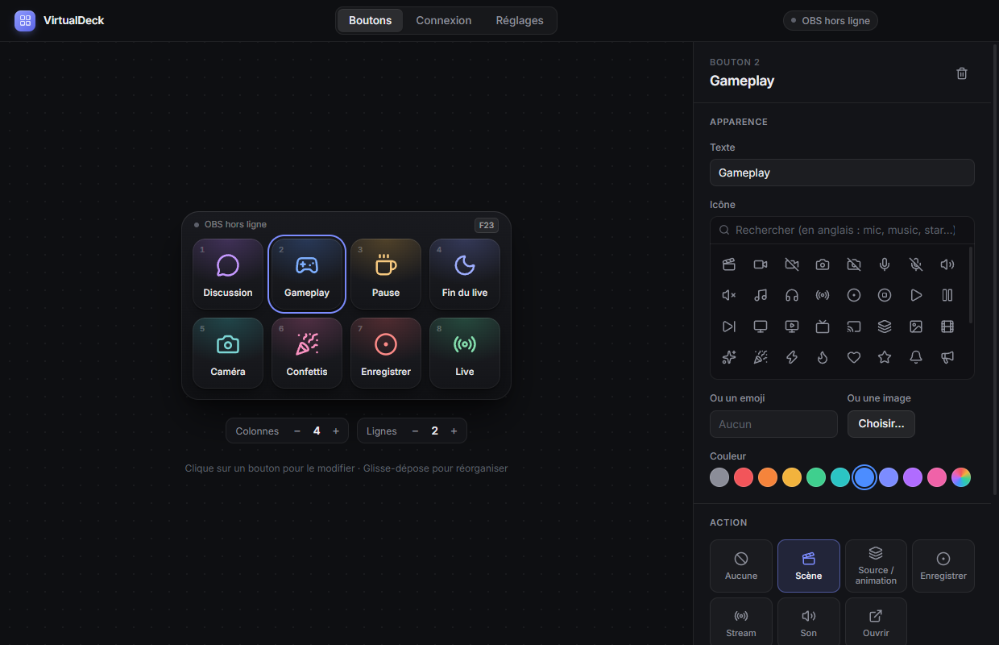
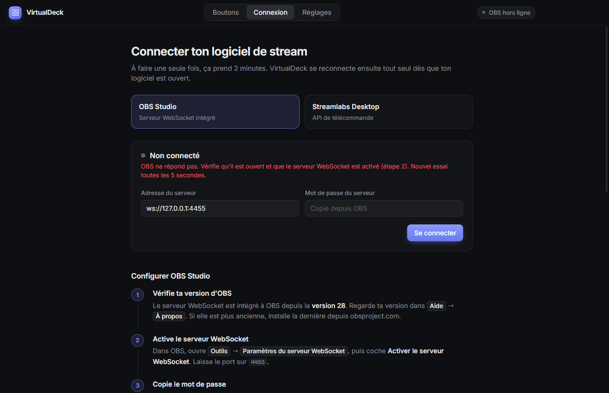
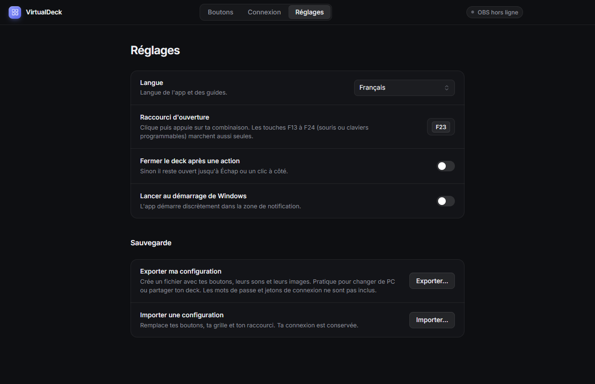

<p align="center">
  
</p>

<h1 align="center">VirtualDeck</h1>

<p align="center">
  Un Stream Deck virtuel pour Windows.<br />
  Un raccourci clavier ouvre une grille de boutons sous ta souris : un clic change de scène OBS, lance une animation, joue un son ou ouvre un programme.
</p>

<p align="center">
  
  <br />
  <sub>Vidéo en meilleure qualité : <a href="docs/demo.mp4">docs/demo.mp4</a></sub>
</p>

---

## Fonctionnalités

- **Une grille qui s'ouvre où tu es** : `Ctrl + Maj + Espace` (modifiable) l'affiche sous la souris, par-dessus les jeux en plein écran fenêtré. `Échap` ou un clic à côté la ferme. Les touches `1` à `9` déclenchent les boutons au clavier.
- **Pilote OBS Studio et Streamlabs Desktop** : scènes, sources et animations, sons coupés, clips, live et enregistrement.
- **État en direct sur les boutons** : badge LIVE sur la scène à l'antenne, chrono « LIVE 1:02:03 » et « REC 12:03 » (ou « PAUSE ») sur les boutons Stream et Enregistrer, « MUET » sur un son coupé. Tout suit aussi ce que tu fais directement dans OBS.
- **Multi-actions** : un seul bouton enchaîne plusieurs actions, avec une attente possible avant chacune (par exemple « Pause » : scène Pause, puis musique, puis webcam masquée).
- **Pages** : jusqu'à 10 grilles, chacune avec son nom (« Sons », « Scènes »…) et son propre nombre de colonnes et de lignes. Elles s'ouvrent dans le deck ou dans une bulle qui sort du bouton, au-dessus du deck (au choix dans les Réglages).
- **Ton téléphone comme deck** : scanne un QR code et ton téléphone devient un Stream Deck tactile, sur le wifi de la maison, sans appli à installer et sans rien ouvrir sur internet.
- **Raccourci par bouton** : déclenche n'importe quel bouton de partout, sans ouvrir le deck (les touches F13 à F24 marchent seules).
- **Format vertical (TikTok, Shorts…)** avec le plugin [Aitum Vertical](https://github.com/Aitum/obs-vertical-canvas) : scènes, sources, live, enregistrement et clips en horizontal, en vertical ou les deux en même temps.
- **Sons** (mp3, wav, ogg…) avec réglage du volume ; un second clic coupe le son.
- **Ouvrir** un programme, un fichier ou un lien (`https://`, `spotify:`, `steam://`, `discord://`…).
- **Lumières Philips Hue** : allume, éteins, change la couleur ou lance une scène de tes lampes, en passant par le pont Hue de la maison (sans compte Hue).
- **Lumières Govee** : allume, éteins ou change la couleur de tes lampes Govee, directement sur le réseau de la maison (sans compte Govee).
- **Personnalisation** : plus de 2 000 icônes, emojis ou tes propres images, 10 couleurs ou une couleur libre, grille jusqu'à 8 × 6. Le deck se déplace et se redimensionne (60 % à 160 %).
- **Export / import** de toute la configuration (sons et images compris), pour changer de PC ou partager ton deck.
- **Mises à jour en un clic** : une pastille dans l'éditeur prévient quand une nouvelle version sort ; un clic la télécharge, l'installe et relance VirtualDeck.
- **6 langues** : français, anglais, espagnol, allemand, italien, portugais (ou automatique selon Windows).
- Tourne discrètement dans la zone de notification, peut se lancer au démarrage de Windows.

## Captures

<table>
  <tr>
    <td width="50%"><br /><sub>Le deck, ouvert par le raccourci</sub></td>
    <td width="50%"><br /><sub>Éditeur : apparence et action de chaque bouton</sub></td>
  </tr>
  <tr>
    <td><br /><sub>Connexion à OBS ou Streamlabs, avec guide pas à pas</sub></td>
    <td><br /><sub>Réglages : langue, raccourci, taille du deck, pages, sauvegarde</sub></td>
  </tr>
</table>

## Installation

Pas besoin de Node.js ni de npm : l'installateur contient tout.

1. Va sur la [dernière version](https://github.com/ThomasLpgs/VirtualDeck/releases/latest) et télécharge `VirtualDeck-Setup-x.y.z.exe` dans la section **Assets**.
2. Lance-le et suis l'installateur. Windows SmartScreen peut afficher « Windows a protégé votre ordinateur » car l'app n'est pas signée par un éditeur reconnu : clique sur **Informations complémentaires** puis **Exécuter quand même**.
3. VirtualDeck s'ouvre sur l'éditeur. Ensuite, il vit dans la zone de notification (à côté de l'horloge).

Pour mettre à jour, clique sur **Installer la mise à jour** en haut de l'éditeur (ou dans le menu de l'icône près de l'horloge) : VirtualDeck télécharge la nouvelle version, vérifie que le fichier est intact, l'installe et se relance. Tu peux aussi lancer le nouvel installateur toi-même. Dans les deux cas, tes boutons, tes réglages et l'épingle de la barre des tâches sont conservés.

## Premiers pas

### 1. Connecter OBS

Dans l'onglet **Connexion** de VirtualDeck :

1. Dans OBS (version 28 ou plus), ouvre **Outils → Paramètres du serveur WebSocket** et coche **Activer le serveur WebSocket** (port `4455`).
2. Clique sur **Afficher les informations de connexion** et copie le mot de passe.
3. Colle-le dans VirtualDeck et clique sur **Se connecter**. La pastille passe au vert.

Pour **Streamlabs Desktop** : **Settings → Remote Control**, clique sur le QR code puis **Show details**, et copie l'**API Token**.

### 2. Créer tes boutons

Dans l'onglet **Boutons**, clique sur une case puis choisis :

| Action | Ce que fait le bouton |
| --- | --- |
| **Scène** | Passe sur la scène choisie (la liste vient directement d'OBS). Avec Aitum Vertical : une scène horizontale et/ou une scène verticale, changées ensemble. |
| **Source / animation** | *Animation* : affiche la source, attend sa durée puis la cache (idéal pour une vidéo `.webm` transparente). *Basculer*, *Afficher*, *Masquer* : contrôle la visibilité. Avec Aitum Vertical : la même animation en horizontal et en vertical. |
| **Muet** | Coupe ou réactive une source audio (micro, musique…). Le bouton affiche « MUET » en rouge tant qu'elle est coupée. |
| **Clip** | Sauvegarde les dernières secondes dans un fichier vidéo (tampon de relecture d'OBS, à démarrer dans OBS). En vertical avec le Backtrack d'Aitum. |
| **Enregistrer** | Démarre ou arrête l'enregistrement, avec le chrono sur le bouton. |
| **Stream** | Démarre ou arrête le live, avec le chrono sur le bouton. |
| **Son** | Joue un fichier audio, ou le coupe s'il est en cours. |
| **Ouvrir** | Lance un programme, un fichier ou un lien. **Utiliser l'icône de l'application** met l'icône du programme (Spotify, OBS…) sur le bouton. |
| **Lumières Hue** | Allume, éteint ou bascule une lampe, une pièce, une zone ou toutes les lampes, avec une luminosité et une couleur au choix ; ou lance une scène Hue. Le pont s'associe dans **Réglages › Lumières connectées**. |
| **Lumières Govee** | Allume, éteint ou bascule une lampe Govee ou toutes à la fois, avec une luminosité et une couleur au choix. Il faut activer « Contrôle LAN » sur la lampe dans l'appli Govee Home. |
| **Page** | Va à la page suivante, précédente ou à une page précise, sans fermer le deck. |
| **Multi** | Enchaîne plusieurs de ces actions dans l'ordre, avec une attente possible avant chacune. Si une étape échoue, les suivantes s'exécutent quand même. |

En bas des réglages de chaque bouton, **Raccourci** lui donne une combinaison de touches qui le déclenche de n'importe où.

Glisse-dépose les boutons pour les réorganiser. Pour changer un bouton de page, dépose-le sur l'onglet de la page (il prend la première place libre), ou garde-le une demi-seconde au-dessus pour ouvrir la page et le poser où tu veux. Ajoute des pages avec **+** au-dessus de l'aperçu, et donne-leur un nom dans le champ **Nom** sous l'aperçu. Tout est enregistré automatiquement.

### 3. Utiliser le deck

Appuie sur `Ctrl + Maj + Espace` n'importe où (ou sur la touche choisie dans **Réglages** : les touches F13 à F24 des souris et claviers programmables marchent aussi), puis clique sur un bouton.

- **Changer de page** : flèches ‹ › en haut du deck, touches ← → du clavier, ou un bouton **Page**.
- **Déplacer** le deck en le tirant par sa barre du haut : il se rouvre ensuite au même endroit. **Redimensionner** par le coin en bas à droite.
- Dans **Réglages › Ouverture des pages**, *Deck superposé* ouvre les pages dans une bulle qui sort du bouton : re-cliquer sur le bouton ou sur le deck la referme.

### 4. Ton téléphone comme deck (optionnel)

1. **Réglages › Téléphone** : active *Utiliser mon téléphone comme deck*, puis **Afficher le QR code**.
2. Scanne-le avec l'appareil photo du téléphone (même wifi que le PC). Ajoute la page à l'écran d'accueil pour l'ouvrir comme une appli.
3. Si Windows demande une autorisation pour VirtualDeck, accepte-la pour le type de réseau de ta maison (Privé ou Public, indiqué dans **Paramètres › Réseau et Internet**) : c'est ce qui permet au téléphone de se connecter. Le deck téléphone reste protégé par sa propre clé, celle du QR code.

Les pages se changent avec les flèches ou en glissant le doigt. Les badges LIVE / REC / MUET suivent en direct.

**Téléphones autorisés** (1 par défaut, jusqu'à 3 ou sans limite) : les premiers appareils qui scannent le QR code prennent les places, les suivants sont refusés même avec le QR code.

Sécurité : le serveur n'existe que pendant que l'option est activée et n'écoute que sur le réseau local (rien sur la box, rien sur internet). Chaque appui est signé avec une clé secrète transmise par le QR code : un appareil du wifi qui ne l'a pas scanné ne peut rien déclencher, même en rejouant une requête. **Nouveau QR code** déconnecte tous les téléphones. Évite de montrer le QR code en stream : même s'il ne marche que depuis ton wifi, autant le garder pour toi.

### 5. Lumières Philips Hue (optionnel)

1. **Réglages › Lumières connectées** : active **Philips Hue**, puis **Rechercher le pont** et **Associer**. Si le pont n'apparaît pas, saisis son adresse IP (appli Hue › Paramètres › Ponts Hue).
2. Appuie sur le gros bouton rond au centre du pont dans les 30 secondes.
3. Crée un bouton **Lumières Hue** et choisis la lampe ou la pièce, ou une scène.

Tout passe par le réseau de la maison : pas de compte Hue, rien à ouvrir sur la box. La liaison avec le pont est chiffrée et VirtualDeck vérifie à chaque fois que c'est bien ton pont qui répond. Si la box donne une nouvelle adresse au pont, VirtualDeck le retrouve tout seul.

### 6. Lumières Govee (optionnel)

Hue et Govee sont désactivés tant que tu ne les actives pas : sans lumières connectées, VirtualDeck n'envoie aucune requête vers des lampes ou un pont.

1. Dans l'appli **Govee Home**, ouvre ta lampe › **Paramètres** et active **Contrôle LAN** (LAN Control).
2. **Réglages › Lumières connectées** : active **Govee**.
3. Dans VirtualDeck, crée un bouton **Lumières Govee** : les lampes du réseau apparaissent toutes seules. Choisis-en une, ou toutes.

Tout passe par le réseau de la maison : pas de compte Govee, pas d'Internet, rien à ouvrir sur la box ni dans le pare-feu. VirtualDeck n'écoute les réponses des lampes que pendant l'appui sur une touche. Les scènes Govee ne sont pas disponibles en local, seulement l'allumage, la luminosité et la couleur.

### 7. Format vertical avec Aitum Vertical (optionnel)

Si le plugin [Aitum Vertical](https://github.com/Aitum/obs-vertical-canvas) est installé dans OBS, VirtualDeck le détecte tout seul :

- **Scène** et **Source / animation** proposent des champs verticaux en plus des horizontaux ; chaque champ rempli agit sur son format, les deux en même temps si les deux sont remplis.
- **Stream**, **Enregistrer** et **Clip** ont un choix **Sortie** : *Horizontal* (OBS), *Vertical* (Aitum) ou *Les deux*.
- Les sources des scènes verticales nécessitent OBS 32 ou plus récent.

Si le plugin n'est plus détecté, la partie horizontale continue de marcher et le deck signale les boutons concernés.

## Sauvegarde et changement de PC

**Réglages → Exporter ma configuration** crée un fichier `.vdeck` avec tes boutons, leurs sons et leurs images. Sur l'autre PC : **Importer une configuration**. Les mots de passe et jetons de connexion ne sont jamais exportés.

## Développement

Prérequis : Node.js et Windows.

```bash
npm install
npm start          # lance l'app en mode développement
npm run dist       # crée l'installateur dans release/
npm test           # lance les tests automatiques (aussi exécutés par GitHub à chaque push)
```

Organisation du code :

```
src/
├── main.js          processus principal : fenêtres, raccourci global, icône de notification
├── config.js        lecture/écriture de la config (secrets chiffrés via safeStorage)
├── actions.js       exécution des actions des boutons
├── obs.js           client OBS WebSocket v5
├── streamlabs.js    client Streamlabs Remote Control
├── backup.js        export / import
├── updates.js       vérification des nouvelles versions (GitHub Releases)
├── i18n.js          traductions côté processus principal
├── i18n/*.json      un fichier par langue
├── deck/            la grille (fenêtre transparente)
├── editor/          l'éditeur
└── shared/          code commun aux deux fenêtres
test/                tests automatiques (node:test, avec un faux OBS)
```

Ajouter une langue : copie `src/i18n/en.json` vers `src/i18n/<code>.json`, traduis les valeurs, puis ajoute le code dans `LANGUAGES` (`src/i18n.js`). Une clé absente retombe sur l'anglais.
